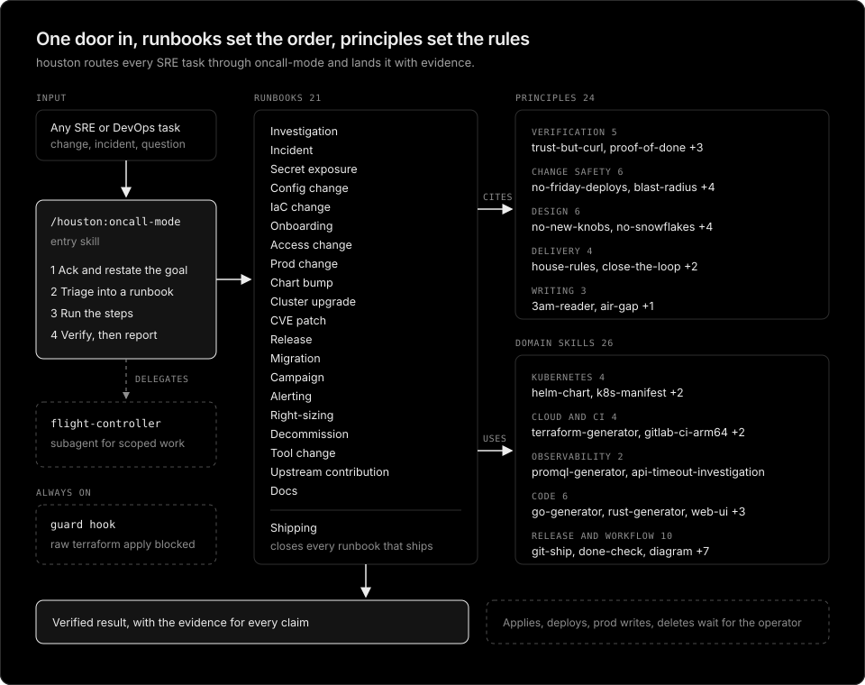

# skills

[](https://github.com/younsl/skills/actions/workflows/check.yml)
[](LICENSE)

Claude Code skill stacks for SRE work, written in the [Agent Skills](https://agentskills.io) format and shipped as a plugin marketplace.

## houston

Houston, we have a task. [houston](houston) is an SRE skill stack modeled on [pstack](https://github.com/cursor/plugins/tree/main/pstack). One entry skill acks every task, triages it into a runbook, and lands it verified. The [philosophy](houston/README.md#philosophy) and the [naming history](houston/README.md#naming) live in the plugin README.



```
houston/
├── skills/
│   ├── oncall-mode/          entry skill and its runbooks/
│   ├── principle-*/          24 engineering principles
│   └── <domain skills>/      26 skills: helm-chart, k8s-manifest, terraform-generator, go-generator, ...
├── agents/
│   └── flight-controller.md  delegate subagent used inside a runbook
└── hooks/
    └── guard.sh              PreToolUse guard, active whenever the plugin is installed
```

- **oncall-mode** restates the goal, picks one of 21 runbooks, and copies its steps into a todo list. Runbooks cover investigation, incidents, secret exposure, config, IaC, onboarding, access, production changes, chart bumps, cluster upgrades, CVE patches, releases, migrations, campaigns across teams, alerting, right-sizing, decommissioning, tool changes, upstream contributions, docs, and shipping.
- **principle-\*** skills carry the rules each runbook step cites, such as `principle-trust-but-curl` (check every fact against the live system), `principle-no-friday-deploys` (production is the operator's button), and `principle-its-always-dns` (measure each layer instead of guessing).
- **Domain skills** hold the conventions for one file type or tool, such as Helm charts, Kubernetes manifests, Terraform, PromQL, Go, Rust, web UIs, MCP servers, CI, Dockerfiles, and diagrams.
- **The guard hook** enforces what must not depend on the model remembering a rule. A raw Terraform, OpenTofu, or Terragrunt `apply` is denied in favor of `tf-safe-apply`, which applies only a saved plan, stops on any delete or replace the request did not name, and requires a clean plan afterwards. `destroy` and state surgery ask the operator first.

## Install

From the marketplace:

```console
/plugin marketplace add younsl/skills
/plugin install houston@younsl
```

From a local clone, so edits load without reinstalling:

```console
$ scripts/install.sh   # links ~/.claude/skills/houston to this checkout
```

Then run `/reload-plugins` and start a task with `/houston:oncall-mode`. Domain skills also work on their own, for example `/houston:helm-chart`.

## Development

```console
$ scripts/check.sh
```

The check validates the marketplace and plugin manifests, the frontmatter and size of every skill, that every principle skill starts with `principle-` and is listed in oncall-mode, that every runbook and principle oncall-mode references exists, the guard hook's allow, ask, and deny cases (`scripts/test-guard.sh`), shellcheck on every script, and that no email address, AWS account ID, or private IP outside the example ranges is committed.

## License

[Apache License 2.0](LICENSE)

## AI Disclosure

The entire codebase of this project was developed with the assistance of [Claude Opus 5.5](https://www.anthropic.com/claude/opus) (High effort).
