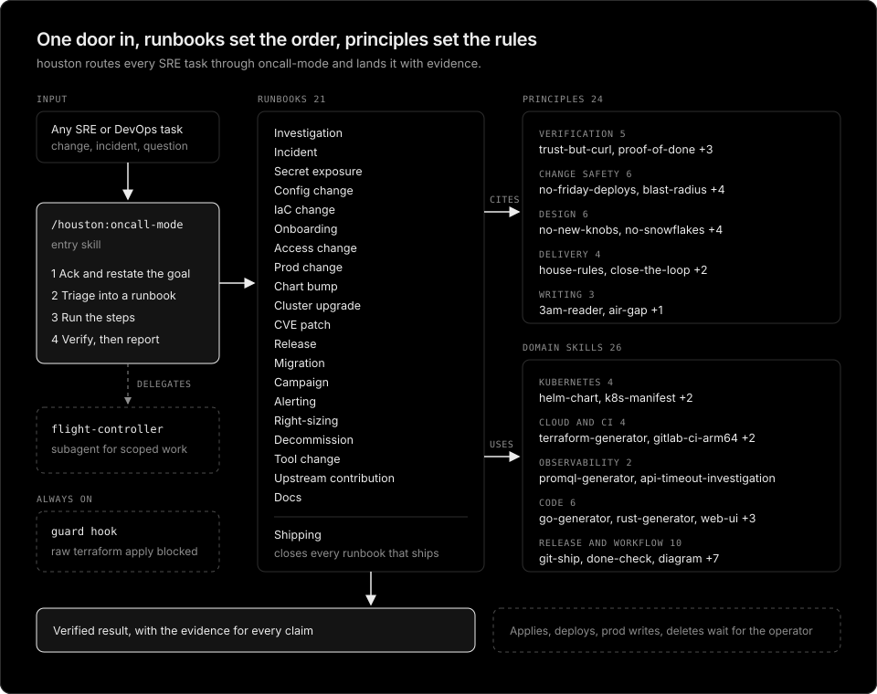

# houston

SRE skill stack for Claude Code. Start any engineering or operations task with `/houston:oncall-mode`. It restates the goal, triages the task into one of 15 runbooks, applies the principle skills each step cites, and hands back a verified result with its evidence.



## Philosophy

Reliable operations come from verified changes, not fast ones. houston turns the habits of a careful on-call engineer into skills an agent loads on demand.

- **One door in.** Every task enters through `oncall-mode`, the way every page reaches the on-call. It acks the task, triages it into a runbook, and owns it until the result is verified.
- **Runbooks carry the order, principles carry the rules.** A runbook is the step sequence for one kind of work. A principle is a leaf skill that a step cites by name, so the same rule (verify against the live system, hand production to the operator) applies the same way in every runbook.
- **Evidence over confidence.** Every fact comes from the live system, every number comes from a query for the window in question, and nothing is called done without checks that ran after the last edit.
- **The operator owns the button.** Reading, local edits, and plans run freely. Applies, deploys, production writes, deletes, and messages to people pause for the operator, and an approval covers one task.
- **Smallest change that solves it.** Change only what was asked, reuse before adding a knob, keep environments identical except for values, and leave upstream text alone.
- **Lessons become structure.** A rule that keeps being repeated turns into a principle skill or a check in `scripts/check.sh`, not into longer prose.
- **Humor lives in names only.** Names like `principle-trust-but-curl` and `principle-its-always-dns` are meant to stick. Descriptions and rules stay plain, because they decide when a skill loads and how it is read at 3am.

The principles were distilled from a few hundred review corrections and working notes collected across real SRE and DevOps work, then generalized for public use.

## Naming

houston is named after mission control. "Houston, we have a problem" is the call made when something goes wrong, and mission control already does what SRE does: launches (releases), telemetry (observability), anomaly response (incidents), resource management (capacity), and procedures (runbooks). The entry skill is `oncall-mode` because it acks and triages like an on-call engineer, and its delegate subagent is the `flight-controller`.

Names considered on the way there:

- **ystack**: a nod to [pstack](https://github.com/cursor/plugins/tree/main/pstack), the stack houston is modeled on, but it described the author rather than the work.
- **nines**: short and very SRE, but it points at availability alone, while SRE also covers latency, correctness, change velocity, efficiency, and toil.
- **lgtm**, **quiet**, **zzz**: funny in review threads and on-call rotations, but they say little about what the stack does.
- **pitcrew**: a clear picture of fixing the car without stopping the race, but narrower than everything SRE covers.
- **armored-runbook**: the right idea of hardened procedures, but long as a skill prefix and centered on incident runbooks only.

## Install

```console
/plugin marketplace add younsl/skills
/plugin install houston@younsl
```

## Contents

- `skills/oncall-mode/`: the entry skill and its `runbooks/`.
- `skills/principle-*/`: engineering principles such as trust-but-curl, proof-of-done, blast-radius, and no-friday-deploys.
- `skills/<name>/`: domain skills for Helm, Kubernetes manifests, Terraform, PromQL, Falco, CI, Dockerfiles, Bash, Rust, releases, Jira, and writing.
- `agents/flight-controller.md`: the delegate subagent oncall-mode spawns inside a runbook step.

Production writes, applies, deletes, and messages to people always pause for the operator. See the [repository README](https://github.com/younsl/skills) for development and checks.
